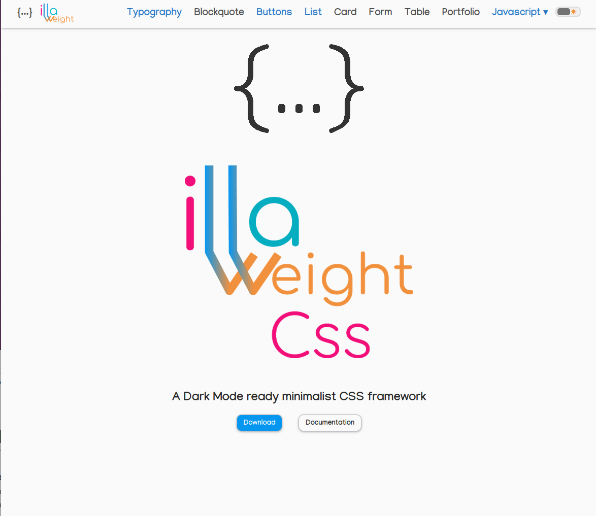

# illaWeightCss

Un framework CSS minimaliste **prêt pour le mode sombre**, fondé sur les
éléments HTML et CSS de la
[documentation Mozilla](https://developer.mozilla.org/fr/) — une grille
responsive 12 colonnes, des utilitaires et des composants interactifs
(modale, onglets, accordéon), le tout dans **~10 kB gzip**.

- Site & documentation : <https://illaweight.illaweb.eu>
- English version (same site) : <https://illaweight.illaweb.eu/en/>
- Licence : [MIT](./LICENSE)


## Fonctionnalités

**illaWeightCss** est un point de départ pour tout site ou application web.
Nous nous chargeons de tout le travail CSS dont un site a besoin, sans pour
autant lui donner un aspect « tout fait » :

- Une grille flex responsive que vous pouvez adapter à vos besoins.
- Une base solide construite sur
  [Normalize.css](https://necolas.github.io/normalize.css/) pour corriger les
  incompatibilités entre navigateurs.
- Des boutons au style homogène, compatibles avec les éléments `<a>` et
  `<button>`.
- Des styles de menus verticaux et horizontaux, avec prise en charge des
  sous-menus déroulants.
- Des alignements de formulaires utiles, agréables sur toutes les tailles
  d'écran.
- Divers styles de tableaux courants.
- Bascule du mode sombre intégrée ([`data-theme`](https://illaweight.illaweb.eu/scripts.html#darkMod)).
- Couleurs **conformes WCAG 2.1 AA** en clair et en sombre (texte ≥ 4.5:1,
  UI ≥ 3:1) : teintes « texte » thématisées + fonds « solides » constants à
  texte blanc garanti.
- Accessibilité intégrée : focus clavier visible, utilitaire `.sr-only`,
  alertes ARIA, piège à focus de la modale, onglets au clavier, animation
  coupée si l'utilisateur la refuse.
- Composants interactifs via `data-attributes` — aucune bibliothèque JS
  requise.
- Un look extrêmement minimaliste, super facile à personnaliser.
- Responsive par défaut, avec une option non responsive.

## Installation

### Depuis Git (recommandé)

Clonez le dépôt et construisez les fichiers distribuables :

```sh
git clone https://github.com/jm-holland/illaweight.git
cd illaweight
npm install
npm run build:lib
```

Puis copiez dans votre projet :

- `illaWeightCss.min.css` (ou `illaWeightCss.css`)
- le dossier `fonts/`
- les scripts dont vous avez besoin dans `js/`

### Via CDN (aucune installation)

Liez directement le fichier depuis GitHub :

```html
<link
  rel="stylesheet"
  href="https://cdn.jsdelivr.net/gh/jm-holland/illaweight@main/illaWeightCss.min.css"
/>
```

ou directement depuis `raw.githubusercontent.com` :

```html
<link
  rel="stylesheet"
  href="https://raw.githubusercontent.com/jm-holland/illaweight/main/illaWeightCss.min.css"
/>
```

### Depuis une Release GitHub

Téléchargez l'archive de la dernière [Release](https://github.com/jm-holland/illaweight/releases)
et copiez les fichiers dans votre projet.

### Via npm (optionnel)

Si vous préférez un gestionnaire de paquets :

```sh
npm install illaweightcss
```

## Démarrage

```html
<!DOCTYPE html>
<html lang="fr">
  <head>
    <link
      rel="stylesheet"
      href="https://cdn.jsdelivr.net/gh/jm-holland/illaweight@main/illaWeightCss.min.css"
    />
  </head>
  <body>
    <main class="container">
      <h1 class="heading-1">Bonjour illaWeight</h1>
      <button class="btn btn-primary">Cliquez-moi</button>
    </main>
  </body>
</html>
```

## Référence des couleurs

Palette **WCAG 2.1 AA** : les teintes « texte » varient selon le thème
(sombre / clair), les **solides** restent constants pour garantir
un texte blanc ≥ 4.5:1 partout (badges, fonds `bg-*`, skip-link, pagination).

| Variable                        | Clair (texte/fond)  | Sombre            |
| ------------------------------- | ------------------- | ----------------- |
| `--color-primary` · `-solid`    |  `#0477BE` |  `#059CFA` |
| `--color-primary-focus`         |  `#035E96` |  `#23A8FB` |
| `--color-highlight` (constant)  |  `#B4F0FE` |  `#B4F0FE` |
| `--color-success` · `-solid`    |  `#037A87` |  `#04A7B9` |
| `--color-success-focus`         |  `#02565F` |  `#05CBE1` |
| `--color-danger` · `-solid`     |  `#B0590C` |  `#EA7610` |
| `--color-error` · `-solid`      |  `#DA0B6C` |  `#F65AA3` |
| `--color-secondary` (constant)  |  `#4D4D4D` |  `#4D4D4D` |
| `--color-muted-solid`           |  `#737373` |  `#737373` |
| `--color-border`                |  `#8C8C8C` |  `#B5B5B5` |

> `.text-secondary` / `.text-muted` = `--color-gray-3` (AA : `#737373` sur
> fond clair, `#DBDBDB` sur fond sombre) — d'où la constante « solide » si le
> gris doit servir de fond à du texte blanc.

## Contenu du paquet

| Chemin                    | Contenu                                         |
| ------------------------- | ----------------------------------------------- |
| `illaWeightCss(.min).css` | bundle CSS unique (polices incluses en relatif) |
| `js/alertMessage.js`      | notifications animées                           |
| `js/interactions.js`      | API `data-attributes` modale / onglets / accordéon |
| `js/menu_burger.js`       | menu hamburger + sous-menus ouverts au clic     |
| `js/portfolio.js`         | léger filtrage de grille portfolio              |
| `js/scrollToTop.js`       | bouton retour en haut                           |
| `js/themeSwitch.js`       | bascule mode sombre / clair persistée          |
| `fonts/`                  | Comfortaa, Manjari, Quicksand + Tabler Icons    |

Documentation complète des classes et des scripts :
<https://illaweight.illaweb.eu>

## Captures d'écran



## Testé sur les navigateurs


## Logo conçu avec


## Exemples de code


## Développé avec


## Langages


## Système d'exploitation


